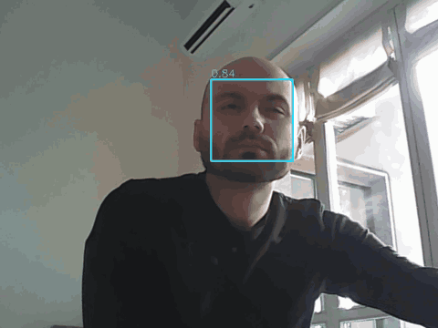

# kriaboard: from "hello world" to face detection in the FPGA of a Kria KV260

<p align="center">
  
  <br>
  <em>Step 5 live on the board: every frame goes through FaceNet in the PL (16.4 ms per frame, 29.9 fps).<br>
  10 s of a 30 s recording made with <code>RECORD = True</code> in <code>kria_face_detect/pynq/face_detect.ipynb</code> (real time, every 3rd frame kept for size).</em>
</p>

A step-by-step path on the AMD Kria KV260 Vision AI Starter Kit, from a first bare-metal program to a neural network that detects faces in a live webcam stream, **computed in the programmable logic (PL)** at camera speed.

Each folder is one step. Every step works on its own, is documented in its own README (objective, what is new, how it prepares the next step, how to build and run it, measured results), and builds on the previous one.

```
webcam ─USB─► Linux (PS) ─► DDR ─► AXI DMA ─► yuyv2gray ─► unpack ─► downscale4x ─► FaceNet (FINN) ─► AXI DMA ─► DDR ─► boxes
                                              └──────────────────────── PL, 16.4 ms per frame ────────────────────┘
```

## Steps

| # | Folder | Objective | New concepts | Hands to the next step |
|---|---|---|---|---|
| 1 | [hello_kria](hello_kria/) | Vivado → Vitis → JTAG → UART flow | Zynq UltraScale+ PS block design, XSA, bare-metal app, `xsct-kit` | a working tool flow and a PS-only block design |
| 2 | [kria_dma_bist](kria_dma_bist/) | AXI DMA loopback, tested from bare-metal C and from Python | AXI DMA (simple mode), AXI-Stream, interrupts, cache handling, throughput model; Ubuntu + PYNQ on the board | the DMA block design used by every later step, and the PYNQ notebook flow |
| 3 | [kria_dma_bist_mod](kria_dma_bist_mod/) | first own AXI-Stream block: YUYV → grayscale | AXI-Stream handshake (`tvalid`/`tready`, backpressure), self-checking testbenches, YUYV webcam frames | `yuyv2gray` and the testbench method |
| 4 | [kria_edge_detect](kria_edge_detect/) | live Sobel edge detection | line buffers, sliding 3×3 window, pipeline drain, width converters (pack/unpack), chaining blocks | the streaming building blocks a CNN layer is made of; the live-webcam notebook |
| 5 | [kria_face_detect](kria_face_detect/) | face detection with a neural network in the PL | FINN (quantized NN → IP), dataset + training (Brevitas), `downscale4x`, integrating a FINN IP | – |

## What you need

- **Board:** KV260 Starter Kit with its **original 12 V supply**, microSD card (≥16 GB), Ethernet, a UVC webcam with YUYV 640×480 (tested: Logitech C170).
- **PC:** Linux with Vivado/Vitis 2022.2; Docker for step 5 (an NVIDIA GPU helps for training).

Setup guides (one-time):

| Guide | For |
|---|---|
| [docs/setup_host.md](docs/setup_host.md) | Vivado/Vitis 2022.2, KV260 board files, JTAG drivers, UART, `xsct-kit`, recreating projects, testbenches |
| [docs/setup_board.md](docs/setup_board.md) | boot firmware, Ubuntu 22.04, Kria-PYNQ, webcam checks, running a step's notebook |
| [docs/setup_finn.md](docs/setup_finn.md) | FINN v0.10 in Docker: install, settings, pitfalls, GPU, where to look |

## Repository conventions

```
<step>/
├── README.md
├── fw/                     hardware
│   ├── create_project.tcl  recreates the Vivado project in fw/prj (not versioned)
│   ├── build.tcl           bitstream + fw/prj/fpga_top.xsa, prints WNS
│   ├── bd/design_1.tcl     block design (write_bd_tcl export)
│   ├── hdl/                VHDL, hdl/tb/ self-checking testbenches
│   └── constraints/
├── sw/src/<app>/           bare-metal C (steps 1-2), built with tools/xsct-kit
├── pynq/                   notebook + export_overlay.sh (XSA → .bit/.hwh for PYNQ)
└── ml/, finn/              (step 5) training and FINN builds
```

Not versioned, regenerated by the scripts: Vivado projects (`fw/prj*`), Vitis workspaces, bitstreams/`.hwh`/`.xsa`, datasets, FINN outputs. Versioned on purpose: the trained FaceNet weights (`kria_face_detect/ml/runs/v1/best.pt`), its ONNX export and `hw_meta.json`, so the hardware can be rebuilt without retraining.

`tools/run_testbenches.sh` runs every testbench and prints one PASS/FAIL line each.

## Results (measured on the board)

| Step | PL design | Result |
|---|---|---|
| 2 | DMA loopback, 32 bit @ 100 MHz | 400 MB/s streaming, 5.4 µs fixed cost per transfer (bare-metal); 921 600-byte frame in 2.7 ms from Python |
| 3 | yuyv2gray | 640×480 frame in 1.90 ms, bit-exact vs OpenCV |
| 4 | yuyv2gray → Sobel 3×3 | 3.43 ms per frame, bit-exact vs numpy, 26.4 fps live |
| 5 | yuyv2gray → downscale4x → FaceNet v1 | 16.4 ms per frame, bit-exact vs PyTorch, **29.9 fps live** (camera limit), 0 DSP in the network |

### Reproduction check

Every step recreated and built from this repository's files alone with `fw/create_project.tcl` + `fw/build.tcl` (2026-10-27, Vivado 2022.2, default strategies, 100 MHz), compared with the original GUI projects:

| Step | WNS | WHS | CLB LUTs | Original project |
|---|---|---|---|---|
| hello_kria | n/a (PS only) | n/a | 0 | 0 |
| kria_dma_bist | +5.466 ns | +0.009 ns | 4 779 | +5.466 ns, 4 779 |
| kria_dma_bist_mod | +5.458 ns | +0.011 ns | 5 185 | +5.638 ns, 5 185 |
| kria_edge_detect | +2.772 ns | +0.010 ns | 5 243 | +2.808 ns, 5 243 |
| kria_face_detect (nn) | +3.821 ns | +0.010 ns | 18 683 | +3.919 ns, 18 683 |
| kria_face_detect (tfc_test) | +2.835 ns | +0.010 ns | 9 917 | – |

The bare-metal apps `hello` and `dma_bist` were rebuilt with `xsct-kit` from the same files. `hello_kria`'s project creation prints a `CRITICAL WARNING [PSU-1]` about the DDR row address count of the KV260 PS preset; it does not stop the build, and the setting comes unchanged from the PS configuration of the original, board-tested project (exported with `write_bd_tcl`).

## Learning notes

The things that made it click, in the order they came up:

1. Throughput = bus width × clock. 32 bit × 100 MHz = 400 MB/s, and the slowest link of the chain sets the pace.
2. Every DMA transfer costs a fixed overhead (5.4 µs bare-metal, 0.4 ms from Python): few big transfers beat many small ones, so widen the DMA length register.
3. PYNQ doesn't flash anything: Linux loads the bitstream into the PL at runtime, and the `.hwh` replaces the Vitis BSP.
4. YUYV = 2 pixels per 32-bit beat, and the Y bytes *are* the grayscale image, for free.
5. AXI-Stream: data moves only at a clock edge where `tvalid` and `tready` are both 1. Nobody "waits": every clock you look at the signals and act.
6. `tvalid` high = my output register is occupied: that data can't be touched until it's taken.
7. `tready` = "I have room *now*" = output empty or emptying at this very clock. Never assume the sink is always ready.
8. Handshake questions are present tense → gates outside the process. The clocked process only decides what the signals look like next clock.
9. If `out_fire` and `in_fire` happen in the same clock, write `out_fire` first: the last assignment wins. One signal = one driver.
10. A correct AXI-Stream block never discards: stalls propagate back to the DMA, which simply waits.
11. At a clock edge, registers still hold the old values: the centre of the new window is `w12`, not `w11`.
12. A line buffer gets overwritten column by column → copy each column into window registers when you read it.
13. A pipeline owes W+1 outputs after the last input (the drain). Output counters are output-image coordinates.
14. Test the boring stuff first: a weak power supply gave a boot loop, and `reboot` doesn't switch the firmware slot; a cold start does.
